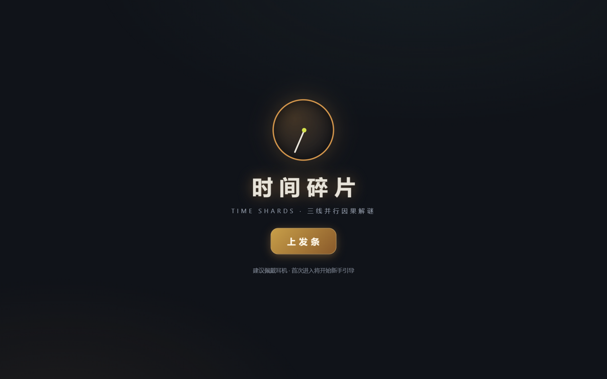

# 时间碎片 Time Shards

> 同时操控**过去、现在、未来**三条时间线，重排因果链的碎片化非线性叙事解谜游戏。
> 本项目是《时间碎片游戏立项策划案》（`D:\固件\游戏计划书\03_时间碎片_游戏计划书.md`）的**可玩网页原型**实现，
> 对应计划书 1.3 的"网页端（WebGL/即点即玩）"首发形态，纯原生 HTML/CSS/JS，零依赖、零构建、可离线游玩。



## 快速开始

```bash
# 方式一：本地服务器（推荐）
cd 本目录
python -m http.server 8945
# 浏览器打开 http://127.0.0.1:8945/index.html

# 方式二：直接双击 index.html（无需服务器）

# 运行测试套件（442 项断言：引擎单元 + 全关卡可解性 + 数据完整性 + 生成器模糊 + 悖论陷阱）
node tests/run_tests.cjs
```

## 玩法（对应计划书 3.1 因果三定律）

每个关卡是一份"时间档案"：三条时间线轨道，每条 2-4 个时间节点（事件快照）。
从**碎片背包**选择操作碎片 → 点击目标节点改写过去 → 涟漪沿因果规则自动传导到现在与未来。

| 定律 | 实现 |
| --- | --- |
| **单向律** | 章节渐进解锁可操作时间线（第 1-2 章只有过去线 → 3-4 章开现在线 → 5 章起三线全开）；非交互线标注"单向律·本线不可操作" |
| **涟漪衰减律** | 每跳衰减 30% 因果强度（100→70→49→34），低于阈值（默认 40）涟漪消散；个别规则设更高阈值（如 55/60）逼迫玩家"在更近的时间线再改一次" |
| **悖论惩罚律** | 同一事实被两条规则写成不同状态（同刻异位）或激活图成环 → **时间风暴**：完整度 -15、回退最近 3 步；满 3 次**时间崩塌**强制重开。悖论护符可抵消一次 |

**胜负与评级**：所有关键节点达成目标态即胜利；星级 = 步数（≤标准解 3★ / ≤1.5× 2★ / 通关 1★）；
得分 = 完好度 50% + 步数 30% + 隐藏碎片 20%（计划书 4.1）。

**特殊机制**：
- `set` 需实体在场 / `trigger` 事件写入 / `move` 同线拖拽搬移 / `plant` **预置闭环**（一次操作同时落"过去的因"与"未来的果"，第 6 章起教学）
- **陷阱碎片**：部分关卡提供"看起来是捷径"的碎片（强行掰闸/踹发电机/举起火把……），使用即触发风暴——用于教学悖论
- **隐藏碎片**：每关可存在非必要解法（喂猫/留一盏灯/无人机测绘……），达成即得"里层真相"碎片

## 内容规模（对应计划书 3.4 / 2.3）

- **102 关** = 8 章 × 12 关 + 6 场章末 BOSS「因果对决」；第 7-8 章含程序化"回响"关
- **114 枚叙事碎片**：日记/录音/监控录像/聊天记录/报纸剪报/车站广播/里层真相，收集驱动碎片化叙事
- **章节记忆**：每章 2 层结局文本（表层/里层，里层需集齐该章隐藏碎片）
- **3 个终局**：结局 A「钟声之下」/ 结局 B「三线共生」（≥12 碎片）/ 里层结局 C「第一次时间的实验」（集齐全部里层碎片）
- **48 个成就**（5 组）：因果大师 / 收藏家 / 速通者 / 完美回环 / 时间考古学家 / 命运观察者
- **5 种道具**（计划书 4.3，全部星尘兑换、付费不卖数值）：时间怀表 / 因果胶水 / 涟漪镜 / 回溯沙漏 / 悖论护符
- **4 种模式**：主线章节、悖论实验室（每日 3 题，构造式生成保证可解）、无限回环（无尽）、时间裂隙（周常种子关，奖励限定外观）

## 操作

| 输入 | 行为 |
| --- | --- |
| 点选碎片 → 点击节点 | 施加操作（所有操作单指可完成，计划书 7.4） |
| 长按节点 | 涟漪推演预览（显示每一跳的传导结果与强度，消散的涟漪标红） |
| `Q` / `E` | 撤销 / 重做（树状回溯，计划书 7.2） |
| `空格` | 切换时间线（仅可交互线循环；切换时三线氛围音乐 300ms 交叉淡入） |
| `R` / `G` / `Esc` | 重开 / 因果星图 / 暂停菜单（内含三级递进提示） |
| 拖拽碎片到节点 | 等价于点选（移动类碎片：拖到来源格再点目标格） |

**游戏说明**：主菜单提供「📖 游戏说明」入口（核心玩法 / 因果三定律 / 操作 / 星级规则 / 小技巧）；首次进入主菜单会自动弹出一次。

**无障碍**（计划书 7.4）：设置内提供色弱模式（三线增加 ⧗⚙✦ 形状铭牌+虚线边框）、大字体、高对比、极简模式；三线除颜色外始终以图标+屏位区分。

## 架构（对应计划书 6.1/6.2：逻辑与表现分离、数据驱动）

```
index.html            入口 + 全部屏幕骨架
css/style.css         铜钟美学：三线配色（琥珀/蓝灰/青紫/品红悖论）70/20/10、玻璃拟态、故障艺术
js/engine.js          ★因果引擎（纯逻辑、零 DOM 依赖、Node 可跑）
                       事件事实表 + 涟漪传播计算器（BFS+衰减）+ 悖论检测器（冲突/成环）
                       + 撤销树（分支保留）+ 风暴回退 + 结算/星级/得分 + 长按预览推演
js/data_levels.js     关卡数据 1/2：章节元信息 + 第 1-4 章手工关（元组式 DSL，策划可读）
js/data_levels_b.js   关卡数据 2/2：第 5-8 章 + 6 BOSS + 程序化生成器（4 个家族、
                       构造式生成"先造解再反推初始"，按章节交互线约束家族）+ 实验室/裂隙
js/data_story.js      叙事数据：碎片库 / 章节双层结局 / 三终局
js/audio.js           程序化音频（WebAudio，无资源文件）：三线氛围配器 + 8 种音效
js/ui.js              全部表现层：屏幕路由 / 棋盘渲染 / 拖拽与点选 / 因果星图 Canvas
                       / 结算与分享卡 / 碎片阅读器 / 四种模式 / 列表页
js/main.js            存档（localStorage + CRC32 校验 + 导出/导入 base64）/ 48 成就 / 启动
tests/run_tests.cjs   测试套件（node tests/run_tests.cjs）
tools/patch_*.py      开发期一次性补丁脚本（保留作开发过程记录，可删）
```

**新增关卡无需写代码**：在 `data_levels*.js` 中按 DSL 追加一个对象即可——

```js
{
  id: 'c9l01', chapter: 9, index: 1, title: '新档案', par: 2,
  slots: { past: 3, present: 3, future: 3 }, interactive: ['past', 'present', 'future'],
  intro: '任务简报……',
  entities: [{ id: 'vase', name: '花瓶', icon: '🏺' }],
  dict: { 'vase.broken': '碎裂', 'vase.intact': '完好' },
  initial: [F('past', 0, 'vase', 'broken')],
  goals:  [F('present', 1, 'vase', 'intact')],
  shards: [SH('trigger', 'fix', '修复花瓶', '🏺', 'vase', 'past', 'intact')],
  rules:  [R('r1', ['past', 0, 'vase', 'intact'], [['present', 1, 'vase', 'intact']])],
  story: ['s9_01'], hint: ['提示一', '提示二'],
}
```

## 测试（对应计划书 6.6：单元测试 + 关卡自动验证器）

`node tests/run_tests.cjs` — **442 项断言全部通过**：

1. **引擎单元测试**（12 组）：传播/衰减数值、阈值阻断、无效操作、单向律、风暴扣分与 3 步回退、崩塌、护符、撤销树分支、同格状态机链、预置闭环、move 语义、空目标关卡
2. **关卡自动验证器**：全部 102 关（含每章回响关）+ 实验室 + 裂隙，DFS 搜索证明"存在 ≤ 标准解步数的解"（3 星可达）
3. **数据完整性**：槽位越界 / 锚点 / 叙事碎片与隐藏碎片引用 / 每章 12 关 / 总量 102 / 里层碎片可获取
4. **生成器模糊测试**：8 章 × 4 家族 × 5 种子 = 160 组，构造解必胜 + 随机 30 连操作不抛异常
5. **悖论陷阱专项**：7 个教学陷阱碎片 + 生成器陷阱，逐一验证触发风暴

## 已知边界（原型范围）

- 云存档 / 排行榜 / 防作弊回放校验 / 支付：按计划书 6.3/6.4 属服务端范畴，原型以本地存档（CRC 校验+导入导出）与本地最高分代替，服务端协议设计见计划书
- 300+ 碎片目标：原型内置 114 枚手写碎片（含全部里层真相），广播合集可在时之铺收录；量产管线（模板组合）在 `data_story.js` 的 `S()` 构造器上扩展即可
- 移动端触屏已适配（响应式布局、pointer 事件、≥44px 热区），未做真机矩阵测试
